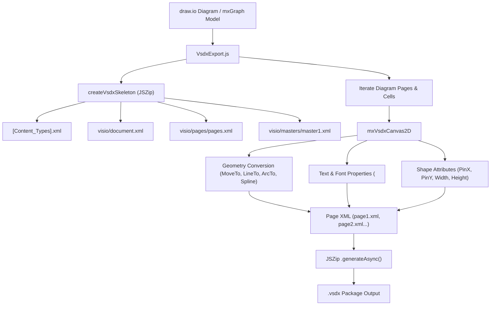

# draw2visio

Extracted and restored Microsoft Visio (`.vsdx`) export engine from [draw.io](https://github.com/jgraph/drawio).

## Background

Native export to `.vsdx` format was removed from draw.io following release `v26.0.16` (see [jgraph/drawio#4942](https://github.com/jgraph/drawio/issues/4942)), with the maintainers citing the maintenance burden of the Visio OpenXML file format. 

While the exporter was minified into `extensions.min.js` and `app.min.js` in older releases, the full unminified source files were briefly checked into the draw.io source tree in commit `947271f1` (Release 28.2.0) before being removed in commits `f61234f5` and `2e967be4`.

This repository extracts and preserves that complete, original unminified source code to serve as the foundation for fixing, improving, and modernizing draw.io-to-Visio conversion quality.

---

## Source Files in this Repository

| File | Description | Original Location |
| :--- | :--- | :--- |
| [`src/VsdxExport.js`](./src/VsdxExport.js) | Main export controller. Manages VSDX packaging (JSZip), OpenXML skeleton creation, pages, layers, relationship files (`_rels`), styles, masters, cell-to-shape mapping, and download trigger. | `src/main/webapp/js/diagramly/vsdx/VsdxExport.js` |
| [`src/mxVsdxCanvas2D.js`](./src/mxVsdxCanvas2D.js) | Canvas implementation extending `mxAbstractCanvas2D`. Intercepts drawing primitives (rect, ellipse, curveTo, text, image, fill, stroke) and translates them into Visio OpenXML geometry rows (`<Section N='Geometry'>`, `<Cell>`, `<Row>`). | `src/main/webapp/js/diagramly/vsdx/mxVsdxCanvas2D.js` |
| [`src/ui-integration.js`](./src/ui-integration.js) | Reference integration hooks from `EditorUi.js` and `Menus.js` showing how draw.io triggered the export action. | Extracted from `EditorUi.js` & `Menus.js` |

---

## Architecture Overview

### Key Technical Details

1. **Visio Coordinate System**:
   - Screen coordinates: Origin `(0,0)` at Top-Left, Y increases downward, measured in pixels.
   - Visio coordinates: Origin `(0,0)` at Bottom-Left, Y increases upward, measured in inches.
   - Conversion factor: `CONVERSION_FACTOR = 101.6` (40 screen pixels/cm × 2.54 cm/inch).
   - Y-inversion formula: `PinY = (pageHeight - (y + height / 2)) / CONVERSION_FACTOR`.

2. **OpenXML Packaging**:
   - A `.vsdx` file is an OPC (Open Packaging Conventions) zip archive containing XML parts and relationships defined by Microsoft Visio 2013+ schema (`http://schemas.microsoft.com/office/visio/2012/main`).

---

## Known Quality Issues in the Original Exporter

The original draw.io exporter was marked "(beta)" and suffered from several well-documented limitations:

1. **HTML & Rich Text Formatting**:
   - `mxVsdxCanvas2D.js` strips most HTML tags or handles them crudely (`//TODO support HTML text formatting and remaining attributes`).
   - Bulleted lists, multi-colored text, bold/italic spans, and custom font weights inside a single label are frequently lost or flattened.
   - Text alignment on rotated shapes is forced to center (`//TODO Fix align and valign for rotated cases`).

2. **Connector Gluing & Routing**:
   - Connectors often lose their dynamic "glue" to shapes when opened in Visio, turning into static lines rather than connected 1D shapes.
   - Orthogonal / waypoint routing in draw.io does not always translate cleanly to Visio's internal routing engine or geometry rows.
   - Connection points (`Connection` sections) are not automatically populated on target 2D shapes for custom anchor points (`exitX/Y`, `entryX/Y`).

3. **Label Background & Styling**:
   - Label background colors and borders often fail to display in Visio (`//TODO for some reason, visio doesn't show the label (text) background color!`).

4. **Embedded Images & SVG Stencils**:
   - SVG shapes are not converted into native Visio vector geometry (`//SVG files cannot be embedded in vsdx files, TODO convert them to a visio shape`).
   - Embedded raster images occasionally have DPI scaling mismatches.

5. **Groups & Hierarchies**:
   - Complex nested containers and groups often have coordinate offset errors due to differing group transformation semantics between mxGraph and Visio ShapeSheets.
